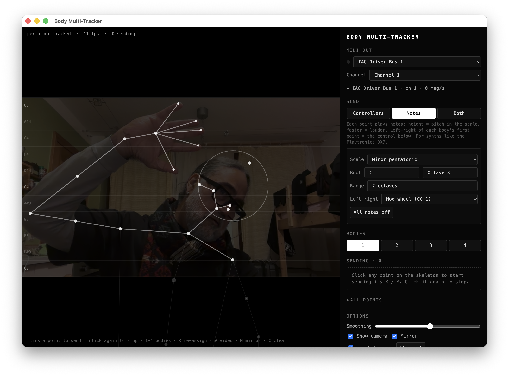
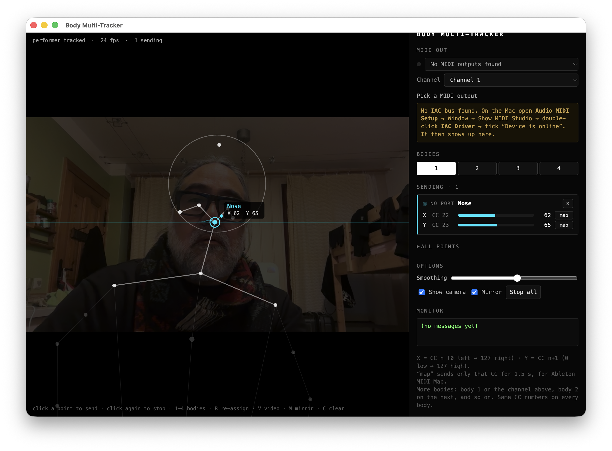

# Body Multi-Tracker

**Turn a dancer's body into a MIDI instrument.** A webcam watches up to four performers. You click
the body points you care about (a hand, a fingertip, the head, a knee), and the app streams their
movement as MIDI to **Ableton Live**, or to any synth that accepts MIDI, including synths running in
another browser window.

It runs in Chrome on your own Mac. Nothing is uploaded: the tracking happens on your computer.

Concept and engineering by **Marlon Barrios Solano**.



*Notes mode: the right hand and its five fingertips are tracked. The faint lines on the left are the
notes of the scale; moving a point up and down plays them. The panel shows the MIDI output
(IAC Driver Bus 1), the send mode and the scale settings.*

---

## Contents

1. [What it does](#what-it-does)
2. [Quick start](#quick-start)
3. [Running the app](#running-the-app)
4. [The screen, explained](#the-screen-explained)
5. [The 46 tracked points](#the-46-tracked-points)
6. [Send modes: Controllers, Notes, Both](#send-modes-controllers-notes-both)
7. [Several bodies](#several-bodies-up-to-4)
8. [**Connecting to Ableton Live, step by step**](#connecting-to-ableton-live-step-by-step)
9. [Browser synths: the Playtronica DX7](#browser-synths-the-playtronica-dx7)
10. [Camera and performance tips](#camera-and-performance-tips)
11. [Troubleshooting](#troubleshooting)
12. [CC table](#cc-table)
13. [Files and credits](#files-and-credits)
14. [License](#license)

New to MIDI? **[HOW-IT-WORKS.md](HOW-IT-WORKS.md)** explains it in plain language, from the camera
to a knob turning in Ableton.

---

## What it does

- **Tracks the whole body** with Google's MediaPipe: 46 points per person, including the head, chest,
  hips, 6 points along each arm and each leg, the palm centre and **all five fingertips**.
- **You choose the points**: click a point to start sending it, click again to stop.
- **Two ways to send:**
  - **Controllers:** each point is two knobs (X and Y, as MIDI CC). You map them to anything in
    Ableton: a filter, a volume, a macro.
  - **Notes:** each point **plays** notes. Height = pitch in a scale, speed = loudness.
- **Up to 4 performers**, each on their own MIDI channel, with the same layout, so you set it up once.
- **Steady in performance:** when a point is lost it holds its last value (or stops its note), and
  notes never hang.
- **A Chrome app** with its own window and Dock icon, which also starts offline.

---

## Quick start

1. **Turn on the Mac's virtual MIDI cable** (once): the [IAC Driver](#step-1--turn-on-the-iac-driver-once).
2. **Start the app**: double-click **`Start Body Tracker.command`** in this folder. It opens in Chrome.
3. **Allow the camera and MIDI** when Chrome asks.
4. In the panel on the right, **MIDI OUT → IAC Driver Bus 1**.
5. **Click a point** on the skeleton, for example your right hand.
6. **In Ableton**, turn on *Remote* for the IAC Driver and map a knob ([details below](#connecting-to-ableton-live-step-by-step)).

---

## Running the app

### Requirements

- **macOS** (Windows works too, see [Windows](#windows)) and **Google Chrome** or Microsoft Edge.
  Safari and Firefox don't support Web MIDI.
- A webcam (built-in is fine) and an internet connection the first time, to load the tracking models.

### Starting it

Double-click **`Start Body Tracker.command`**. It starts a small local web server on port **8765**
and opens the app in its own Chrome window. Keep the Terminal window that appears open while you
use the app.

Or from a terminal:

```bash
cd ~/Desktop/body-multi-tracker && python3 serve.py
```

then open **http://localhost:8765** in Chrome.

> If macOS says the `.command` file can't be opened, right-click it → **Open** → **Open** (only the
> first time).

### Installing it as a Chrome app (optional)

With the app open, click **Install app** at the top of the panel, or use Chrome's install icon in
the address bar (⋮ → *Cast, save and share* → *Install page as app…*). It then has its own window
and a Dock icon. The local server still has to be running, so start it with the `.command` file.
Always install from **http://localhost:8765**: Chrome ties an installed app to that address.

---

## The screen, explained



*Controllers mode with one point selected (the nose). Its X and Y go out as CC 22 and CC 23. In this
picture the MIDI output isn't connected yet ("No MIDI outputs found"); the yellow box says how to fix that.*

**Left: the stage**

- The **skeleton** is drawn live on black. Tick *Show camera* to see the video faintly behind it.
- Every tracked point is a **white dot**. Hover one to see its name and CC numbers, then **click**
  to start sending it.
- A selected point gets a **colour, a pulsing ring, a trail, and crosshairs** showing its X and Y,
  plus a label with its live values.
- **Top line:** tracking status, frame rate (fps) and how many points are being sent.
- **Bottom line:** keyboard shortcuts.

**Right: the panel, top to bottom**

| Section | What it's for |
|---|---|
| **MIDI OUT** | Which MIDI port to send to (choose **IAC Driver Bus 1**) and the channel. The small light blinks when MIDI is sent; the line below shows port, channel(s) and messages per second. |
| **SEND** | *Controllers*, *Notes* or *Both*. In Notes mode: scale, root, octave, range, and what left–right does. |
| **BODIES** | How many performers to track (1–4), *Same points on all bodies*, *Re-assign by position*. |
| **SENDING** | Every selected point, grouped by body: its state, CC numbers, live values (0–127) and bars, the note it's playing, and **map** buttons for Ableton. |
| **ALL POINTS** | Every point as a button, to pick points by name. |
| **OPTIONS** | Smoothing, show camera, mirror, **Track fingers**, **Stop all**. |
| **MONITOR** | The last MIDI messages actually sent, for example `ch1  CC  22   64`. |

**Row states in SENDING**

| State | Meaning |
|---|---|
| **SENDING** | The point is seen and its values are going out. |
| **PLAYING** | Notes mode: the point is playing a note. |
| **HOLD** | The camera lost the point. Its last values are kept and nothing new is sent, so Ableton stays where it was. |
| **SILENT** | Notes mode: the point is lost, so its note was stopped. |
| **NO PORT** | No MIDI output chosen. |
| **MAPPING X / Y** | The *map* button is sending only this CC, for Ableton's MIDI Map. |
| **WAITING** | Selected, but the body hasn't been seen yet. |

**Keys:** **F** full screen · **H** hide/show the panel · **1–4** number of bodies ·
**R** re-assign bodies left to right · **V** camera · **M** mirror · **C** stop all.

### Full screen and hiding the panel

- **⛶ Full screen** (top of the panel, or key **F**) fills the whole screen: no white title bar, no
  browser, no Dock. Press **Esc** or **F** to leave.
- **Hide panel** (or key **H**) gives the stage the whole window, which is good for performing or
  projecting. MIDI keeps running. A small **Show panel** / **Full screen** button stays in the top
  right corner; it is faint until you move the mouse over it.
- Use both for a clean stage view: **F** then **H**.

Your selection, MIDI port, channel and settings are remembered between sessions.

---

## The 46 tracked points

"Left" and "right" are always the **performer's** own left and right.

| Group | Points |
|---|---|
| **Head** | head top, nose, left/right eye, left/right ear |
| **Torso** | neck, chest, belly, pelvis (hip centre), left/right hip |
| **Each arm** | shoulder, upper arm, elbow, forearm, wrist, hand (palm centre) |
| **Each leg** | thigh, knee, shin, ankle, heel, toes |
| **Each hand's fingers** | thumb, index, middle, ring, pinky (fingertips) |

Some points come straight from MediaPipe; others are worked out from them. The **head top** is
estimated from the eyes, mouth and ears. **Neck, chest, belly, pelvis** sit between the shoulders
and hips. **Upper arm, forearm, thigh, shin** are the middle of each bone. The **hand** and
**fingertips** come from MediaPipe's dedicated hand model (21 points per hand). When it can't see a
hand, the app estimates them from the body model (rougher; middle and ring are guessed). Turn
*Track fingers* off to skip the hand model and gain speed.

---

## Send modes: Controllers, Notes, Both

Choose under **SEND** in the panel.

### Controllers (for mapping knobs in Ableton)

Each selected point sends **two MIDI Control Change (CC) messages**:

- **X** on CC *n*: 0 = left edge of the frame, 127 = right edge.
- **Y** on CC *n + 1*: 0 = bottom, 127 = top, so raising a hand **raises** the value.

Every point has **fixed CC numbers** (see the [CC table](#cc-table)): the nose is always CC 22/23 and
the right hand always CC 66/67. Your Ableton mappings never move when you select other points. A value
is only sent when it changes.

### Notes (for playing a synth)

Each selected point **plays notes**:

- **Height = pitch.** The frame is divided into the notes of a scale, shown as faint lines with note
  names on the left of the stage. When a point crosses into the next line, the old note stops and the
  new one starts. A small dead zone stops a hand resting on a line from flickering between two notes.
- **Speed = loudness** (velocity 55–127).
- **Left–right** of each body's first selected point moves the **mod wheel (CC 1)** or **pitch bend**,
  or nothing.
- **Scale, root, octave, range:** for example *Minor pentatonic, C, Octave 3, 2 octaves* covers
  C3 to C5. Pentatonic scales always sound in key, so they're a good start.
- **Each selected point is its own voice.** Five fingertips = five notes at once.
- A lost point **stops its note**. Changing mode, scale or number of bodies, or closing the app,
  stops all notes. **All notes off** does it by hand.

### Both

Notes and controllers at the same time. Right wrist X (CC 64) is not sent in this mode, because
synths read CC 64 as the sustain pedal.

---

## Several bodies (up to 4)

Under **BODIES**, choose **1, 2, 3 or 4** (or press 1–4).

- **Each body has its own colour and its own MIDI channel.** Body 1 uses the channel chosen in the
  panel; the others follow. By default: **Body 1 → ch 1, Body 2 → ch 2, Body 3 → ch 3, Body 4 → ch 4.**
- **Every body uses the same CC numbers.** Only the channel tells the dancers apart, and Ableton
  treats "ch 2, CC 66" and "ch 1, CC 66" as different controls.
- A tag above each head shows **BODY 2 · ch 2**. If a body is lost, it says **HOLD**.
- **Clicking a point selects it on that body only.** Tick **Same points on all bodies** to select a
  point on everyone with one click.
- **Re-assign by position** (key **R**) numbers the dancers from left to right. Do it at the start of
  a piece.

**Who is who:** the camera doesn't know the dancers. The app follows each person from frame to
frame by where their torso was a moment ago, so they keep their number and channel while they move.
Someone who leaves gets their number back when they return. If dancers cross or overlap, two numbers
can swap: press **R**.

---

## Connecting to Ableton Live, step by step

### The big picture

```
 camera ─▶ Body Multi-Tracker (Chrome) ─▶ IAC Driver Bus 1 ─▶ Ableton Live
                                          (virtual MIDI cable   ├─ Remote: map knobs (Controllers)
                                           built into macOS)    └─ Track: play instruments (Notes)
```

Chrome sends MIDI into the **IAC Driver**, a virtual MIDI cable that's built into macOS. Ableton
listens to the same cable. **Steps 1–3 are done once**; after that you only map knobs or set up
tracks.

---

### Step 1 · Turn on the IAC Driver (once)

1. Open **Audio MIDI Setup**: press **⌘Space**, type *Audio MIDI Setup*, press Return. (It's also in
   Applications → Utilities.)
2. It opens on the **Audio Devices** window (microphones and speakers). **That's not the one you
   need.**
3. In the **menu bar at the top of the screen**, click **Window → Show MIDI Studio** (or press **⌘2**).
4. The **MIDI Studio** window shows a grid of icons. **Double-click the red IAC Driver icon.**
5. Tick **Device is online**.
6. Under **Ports**, there should be **Bus 1**. If the list is empty, click **+**.
7. Click **Apply** and close the window. It stays on after restarting the Mac.

---

### Step 2 · Choose the IAC Driver in the app

1. Start the app (**Start Body Tracker.command**) and allow **camera** and **MIDI** in Chrome.
2. Under **MIDI OUT**, choose **IAC Driver Bus 1**. It's picked automatically when it exists. If you
   turned the IAC Driver on after opening the app, reload with **⌘R**.
3. Leave the channel on **Channel 1**. Once you've mapped things in Ableton, keep it the same.
4. **Check:** click a point and move it. The light next to MIDI OUT blinks and **MONITOR** lists
   messages like `ch1  CC  66   87`.

---

### Step 3 · Let Ableton listen (once)

1. In Ableton Live: **Live → Settings…** (⌘,). In older versions it's *Preferences*.
2. Open the **Link, Tempo & MIDI** tab (*Link/MIDI* in Live 10/11).
3. In **MIDI Ports**, find the row **In: IAC Driver (Bus 1)**.
4. Turn on:
   - **Remote**, to map knobs with the **Controllers** mode.
   - **Track**, to play instruments with the **Notes** mode.
   - Turning on both is fine.
5. For **Out: IAC Driver (Bus 1)** leave everything **off**, so Ableton doesn't send MIDI back into
   the same cable.
6. Close Settings and move a selected point: the **MIDI indicator** at the top right of Live
   (the small square) flashes.

---

### Step 4A · Controllers: map a body point to a knob

Example: **Nose X** (turning or leaning your head) controls a filter.

1. In the app: **SEND → Controllers**, then click the **nose**. Its row says **SENDING**.
2. In Ableton, put an **Auto Filter** on a track.
3. Press **⌘M** (or click **MIDI** at the top right). Everything you can map turns **blue**.
4. Click the Auto Filter's **Frequency** knob.
5. In the app, press **map** next to **X** on the Nose row. For 1.5 seconds the app sends **only
   CC 22**, so Ableton learns exactly that one. Without it, Ableton would grab whichever of the many
   moving CCs arrived last. The row shows **MAPPING X**.
6. The knob now shows a small label such as **1/22** (channel 1, CC 22).
7. Map more: click another knob, press another **map** button. For example Nose **Y** → Resonance.
8. Press **⌘M** again to leave MIDI Map mode. Move your head and the filter follows.

**Shape the response.** While in ⌘M mode, the **MIDI Mappings** list on the left shows one row per
mapping, with **Min** and **Max**:

- Narrow the range (for example a frequency of 200 Hz–5 kHz), so the movement covers the useful part.
- Set Min higher than Max to **invert** it, so moving up turns the knob down.
- Select a row and press **Delete** to remove a mapping.

---

### Step 4B · Notes: play an Ableton instrument

1. In the app: **SEND → Notes**, choose a scale, and click a point (a hand or a fingertip).
2. In Ableton, create a **MIDI track** with an instrument (for example *Operator*, *Wavetable* or *Drift*).
3. In the track's **I/O** section:
   - **MIDI From:** *IAC Driver (Bus 1)*.
   - Channel: **Ch. 1** for body 1 (or *All Channels*).
   - **Monitor: In**, or arm the track.

   If you can't see the I/O section, use **View → Show In/Out**.
4. Move: the instrument plays. Left–right moves the mod wheel; in the instrument you can choose what
   the mod wheel does.
5. Record it: arm the track and press Record. The notes land in a clip like any MIDI keyboard's.

---

### Step 4C · Several dancers in Ableton

Each body sends on its own channel, so give each dancer **their own track or mappings**:

- **Notes:** one MIDI track per dancer. Track 1: *MIDI From IAC Driver, Ch. 1*. Track 2: *Ch. 2*.
  And so on, each with a different instrument. Now each dancer has their own sound.
- **Controllers:** map as in step 4A. Press **map** on the row of the body you want (the panel
  groups rows by body); the label shows the channel, for example **2/66** = body 2's right hand X.
- Remote listens to all 16 channels, so nothing else needs setting up.

---

### Step 5 · Tips for a performance set

- **Map to Rack macros.** Put instruments and effects in an Audio or Instrument Rack and map body
  points to its **Macro** knobs. One macro can drive several parameters, each with its own range,
  and the mapping survives if you swap devices inside the rack.
- **Choose independent points.** Nose, eyes and head top move together. Head top Y, one hand and the
  pelvis make a more expressive set.
- **Smoothing** (OPTIONS) calms jitter; lower it for fast hits.
- **Takeover Mode** (Settings → Link, Tempo & MIDI): *None* lets the body's value jump straight in,
  which is usually what you want.
- **Save the Live Set.** Mappings are saved in it. The CC numbers never change, so they keep working
  every time.
- **Ideas:**
  - Head top Y → filter: crouch to close it, stand tall to open it.
  - Right hand Y → a send to a reverb.
  - Pelvis X → crossfade between two sounds as you cross the stage.
  - Fingertips in Notes mode → chords.

---

### Windows

Windows has no built-in virtual MIDI cable. Install **loopMIDI** (Tobias Erichsen), create a port,
choose it in the app, and enable **Remote**/**Track** for it in Ableton. Everything else is the same.

---

## Browser synths: the Playtronica DX7

MIDI also goes **from browser window to browser window** through the same IAC cable. Example: the
[DX7 synth at synth.playtronica.com](https://synth.playtronica.com/dx7/), Matt Montag's DX7 emulator.

1. IAC Driver on ([step 1](#step-1--turn-on-the-iac-driver-once)).
2. In the tracker: **MIDI OUT → IAC Driver Bus 1**, **SEND → Notes**, click a point.
3. Open https://synth.playtronica.com/dx7/ in Chrome and allow MIDI.
4. In the DX7, set its **MIDI input** menu to **IAC Driver Bus 1**. It doesn't pick it by itself.
5. **Click once** on the DX7 page, so Chrome allows it to make sound.
6. Move: the DX7 plays. Try different patches.

Good to know: the DX7 plays notes and only reacts to the mod wheel (CC 1), sustain (CC 64), pitch
bend and aftertouch, so **Controllers** mode does nothing there. It also uses one sound for all
channels, so for a different sound per dancer, use Ableton ([step 4C](#step-4c--several-dancers-in-ableton)).

---

## Camera and performance tips

- **Frame:** for whole-body work, every dancer must be in frame from head to feet. For finger work,
  get closer so the hands look large.
- **Light:** even light from the front. Avoid a bright window behind the performer.
- **Speed:** the frame rate is shown at the top left. The hand model costs the most: the screenshot
  above runs at 11 fps with fingers on. If it's slow:
  - Turn off **Track fingers** when you don't need fingertips.
  - Set **BODIES** to the number of people actually on stage.
  - Close other heavy apps.
- **Distance between dancers:** someone hidden behind another person goes on HOLD until seen again.

---

## Troubleshooting

| Problem | Fix |
|---|---|
| **MIDI OUT says "No MIDI outputs found"** | The IAC Driver isn't online ([step 1](#step-1--turn-on-the-iac-driver-once)). Then reload the app (⌘R). |
| Audio MIDI Setup shows microphones and speakers, no IAC | That's the Audio Devices window. Menu bar → **Window → Show MIDI Studio** (⌘2). |
| "MIDI permission was blocked" | Click the icon left of Chrome's address bar → allow **MIDI devices** → reload. |
| The panel has no SEND section, or old features | The window is showing an old copy. Check the address is **localhost:8765** and press ⌘R (or ⌘⇧R). |
| MONITOR shows messages but Ableton doesn't react | **Remote** (for knobs) or **Track** (for notes) isn't on for *In: IAC Driver* ([step 3](#step-3--let-ableton-listen-once)). |
| Notes mode: the Ableton instrument is silent | Track's *MIDI From* = IAC Driver, the right channel, **Monitor: In** ([step 4B](#step-4b--notes-play-an-ableton-instrument)). |
| A mapping grabbed the wrong axis or point | Delete it in the MIDI Mappings list and use the **map** button. |
| Mappings stopped working | The channel in the app changed. Set it back to the one you mapped with. |
| Two dancers swapped channels | They crossed or overlapped. Press **R** (Re-assign by position). |
| I can't see everything / the window is too small / the white bar is in the way | Press **F** for full screen (Esc leaves) and **H** to hide the panel. |
| Values jitter | Raise **Smoothing**; improve the light; keep the body fully in frame. |
| Low frame rate | Turn off **Track fingers**; set BODIES to the real number of people. |
| A row says **HOLD** / **SILENT** | The camera can't see that point. It continues when the point is seen again. |
| A note keeps sounding | Press **All notes off** in the panel. |

---

## CC table

The same on every body; the channel is that body's channel. **X** = left (0) → right (127),
**Y** = bottom (0) → top (127).

| Group | Point | X CC | Y CC |
|---|---|---|---|
| Head | Head top | 20 | 21 |
| Head | Nose | 22 | 23 |
| Head | Left eye | 24 | 25 |
| Head | Right eye | 26 | 27 |
| Head | Left ear | 28 | 29 |
| Head | Right ear | 30 | 31 |
| Torso | Neck | 32 | 33 |
| Torso | Chest | 34 | 35 |
| Torso | Belly | 36 | 37 |
| Torso | Pelvis (hip centre) | 38 | 39 |
| Torso | Left hip | 40 | 41 |
| Torso | Right hip | 42 | 43 |
| Left arm | Left shoulder | 44 | 45 |
| Left arm | Left upper arm | 46 | 47 |
| Left arm | Left elbow | 48 | 49 |
| Left arm | Left forearm | 50 | 51 |
| Left arm | Left wrist | 52 | 53 |
| Left arm | Left hand | 54 | 55 |
| Right arm | Right shoulder | 56 | 57 |
| Right arm | Right upper arm | 58 | 59 |
| Right arm | Right elbow | 60 | 61 |
| Right arm | Right forearm | 62 | 63 |
| Right arm | Right wrist | 64 | 65 |
| Right arm | Right hand | 66 | 67 |
| Left leg | Left thigh | 68 | 69 |
| Left leg | Left knee | 70 | 71 |
| Left leg | Left shin | 72 | 73 |
| Left leg | Left ankle | 74 | 75 |
| Left leg | Left heel | 76 | 77 |
| Left leg | Left toes | 78 | 79 |
| Right leg | Right thigh | 80 | 81 |
| Right leg | Right knee | 82 | 83 |
| Right leg | Right shin | 84 | 85 |
| Right leg | Right ankle | 86 | 87 |
| Right leg | Right heel | 88 | 89 |
| Right leg | Right toes | 90 | 91 |
| Left fingers | Left thumb | 92 | 93 |
| Left fingers | Left index | 94 | 95 |
| Left fingers | Left middle | 102 | 103 |
| Left fingers | Left ring | 104 | 105 |
| Left fingers | Left pinky | 106 | 107 |
| Right fingers | Right thumb | 108 | 109 |
| Right fingers | Right index | 110 | 111 |
| Right fingers | Right middle | 112 | 113 |
| Right fingers | Right ring | 114 | 115 |
| Right fingers | Right pinky | 116 | 117 |

The finger CCs skip 96–101, which synths read as data entry / RPN / NRPN.

---

## Files and credits

Concept and engineering by **Marlon Barrios Solano**.

| File | What it is |
|---|---|
| `index.html` | The page, panel and styles |
| `sketch.js` | The p5.js sketch: camera, identity tracking, drawing, clicking, sending |
| `points.js` | The 46 points, derived points, skeleton lines, CC numbers |
| `pose.js` | MediaPipe Pose Landmarker (bodies) and Hand Landmarker (fingers) |
| `midi.js` | Web MIDI output: CC, notes, pitch bend |
| `notes.js` | Notes mode: scales, height → pitch, velocity |
| `ui.js` | The right-hand panel |
| `serve.py` | Local no-cache web server (port 8765) |
| `Start Body Tracker.command` | Double-click launcher |
| `sw.js`, `manifest.webmanifest`, `icons/` | Chrome app (PWA) and offline support |
| `HOW-IT-WORKS.md` | Plain-language guide |
| `docs/` | Screenshots |

Built with [p5.js](https://p5js.org) and Google's
[MediaPipe](https://ai.google.dev/edge/mediapipe/solutions/vision/pose_landmarker) Pose and Hand
Landmarker. The DX7 synth is by Matt Montag ([dx7-synth-js](https://mmontag.github.io/dx7-synth-js/)),
hosted by Playtronica.

---

## License

[MIT](LICENSE) © 2026 Marlon Barrios Solano. You may use, copy, modify and share this software,
including commercially, as long as the copyright and license notice are kept.

MediaPipe (Apache 2.0) and p5.js (LGPL 2.1) are loaded from their CDNs and keep their own licenses.
